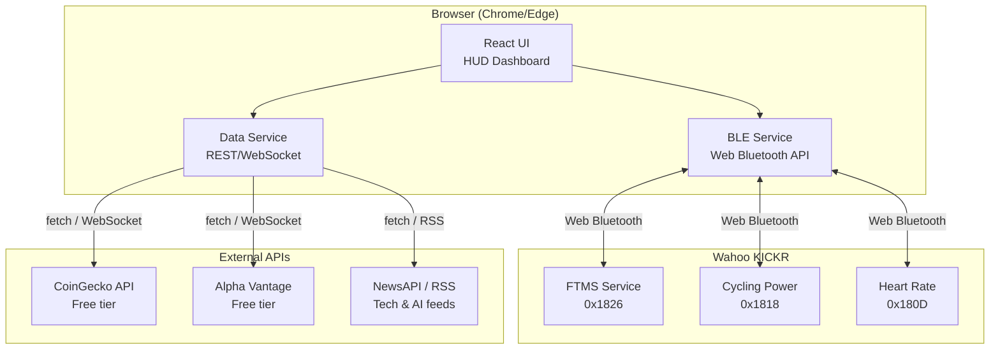

# Stock Rider — Feasibility & Implementation Plan

## 💡 The Concept

**Stock Rider** = Indoor cycling + real-world knowledge. Ride your Wahoo KICKR while consuming live financial data, news, and tech/AI content — no virtual world, just reality.

> **This concept is genuinely novel.** No existing cycling app (Zwift, TrainerRoad, Rouvy, MyWhoosh, Fulgaz) combines indoor training with real-world financial/news data. The closest related concept is "Move-to-Earn" (Web3 fitness), but that's gamified crypto rewards — not a learning/information platform.

---

## ✅ Is This a Good Idea?

### Strengths

| Aspect | Assessment |
|---|---|
| **Blue ocean** | Zero direct competitors combining cycling + real data feeds |
| **YouTube synergy** | Perfect format — record sessions discussing tech/AI/startups while cycling. Unique visual hook |
| **Web Bluetooth** | Wahoo KICKR supports FTMS (Fitness Machine Service) over BLE. No native app needed — runs in Chrome |
| **Target audience** | Tech-savvy cyclists, fintech enthusiasts, busy professionals who want to multi-task |
| **Low barrier** | Web app = no app store approval, instant updates, works on any device with Chrome |
| **Content flywheel** | Every ride = potential YouTube episode; every YouTube viewer = potential user |

### Risks & Mitigations

| Risk | Mitigation |
|---|---|
| Web Bluetooth only works in Chromium browsers | Target Chrome/Edge (80%+ market share). Clear browser requirement on landing page |
| HTTPS required for Web Bluetooth | Deploy to Vercel/Netlify (free HTTPS). For local dev, use `localhost` (exempt) |
| Financial data APIs can be expensive | Start with free tiers: CoinGecko (free), Alpha Vantage (free tier), NewsAPI.org (free/dev) |
| Niche audience | Lean into it — niche = passionate community. YouTube channel amplifies reach |
| Wahoo-only initially | FTMS is a BLE standard — any FTMS-compatible trainer will work (Tacx, Elite, etc.) |

### Verdict: **Strong idea, worth building.** Unique positioning, technically feasible, and the YouTube channel creates a natural marketing loop.

---

## 🔍 Open-Source Reuse Analysis

### [BFree](https://github.com/bfree-trainer/bfree) — ⭐ Primary reference

| Aspect | Details |
|---|---|
| **Stack** | Next.js, Web Bluetooth, TypeScript |
| **License** | Open source |
| **What to reuse** | BLE connection patterns, FTMS protocol parsing, characteristic read/write logic |
| **What to skip** | Their UI, workout logic, data storage patterns |
| **Fit** | Excellent — same core problem (connect to trainer via Web Bluetooth) |

### [Incyclist](https://github.com/incyclist/desktop) — 📎 Secondary reference

| Aspect | Details |
|---|---|
| **Stack** | Electron, JavaScript |
| **Why not primary** | Desktop-only (Electron), heavy dependencies (MQTT, Google Maps, Strava, JAWG). Over-engineered for our needs |
| **What to reuse** | Protocol understanding, FTMS spec interpretation |

---

## 🏗️ Proposed Architecture



---

## 🛠️ Technology Stack

| Layer | Technology | Rationale |
|---|---|---|
| **Framework** | Vite + React + TypeScript | Fast dev, tree-shaking, modern DX. Lighter than Next.js (no SSR needed for BLE) |
| **Styling** | Vanilla CSS with CSS custom properties | Maximum control for the HUD-style dashboard aesthetic |
| **BLE** | Web Bluetooth API (native) | No library needed — direct browser API. Patterns borrowed from BFree |
| **Charts** | Lightweight charting (e.g., `lightweight-charts` by TradingView, or custom Canvas) | Financial-grade charts that look native to a trading dashboard |
| **Data** | REST APIs with periodic polling | CoinGecko, Alpha Vantage, NewsAPI — all free tier friendly |
| **Hosting** | Vercel | Free, HTTPS out of the box, perfect for React SPAs |

---

## 📐 UI Concept: The "Trading Floor HUD"

The UI should feel like a **Bloomberg Terminal meets cycling cockpit** — dark theme, data-dense, with real-time tickers and your cycling metrics floating alongside market data.

### Layout Zones

```
┌──────────────────────────────────────────────────────────┐
│  📡 STOCK RIDER          [BTC ▲ 52,340]  [ETH ▼ 3,210]  │  ← Top bar: crypto ticker
├────────────────────┬─────────────────────────────────────┤
│                    │                                     │
│   🔋 POWER: 245W  │     📈 MAIN CHART                   │
│   🚴 CADENCE: 88  │     (Stock / Crypto / News Feed)    │
│   ❤️ HR: 155 bpm  │                                     │
│   ⏱️ TIME: 32:15  │                                     │
│   🔥 CALORIES: 420│                                     │
│   📏 DISTANCE: 12k│                                     │
│                    │                                     │
├────────────────────┼─────────────────────────────────────┤
│  POWER GRAPH ~~~~~~│  📰 NEWS / TECH / AI FEED           │
│  (last 5 min)      │  • OpenAI launches GPT-5...         │
│                    │  • NVIDIA earnings beat...           │
│                    │  • Y Combinator W26 batch...         │
└────────────────────┴─────────────────────────────────────┘
```

### Key UI Features
- **Dark theme** with neon accent colors (green for gains, red for losses)
- **Live crypto/stock ticker** scrolling across the top
- **Cycling metrics panel** on the left — power, cadence, HR, time, calories
- **Main content area** — switchable between chart view, news feed, or startup spotlight
- **Power graph** — real-time wattage over time (like a heart monitor)
- **Glassmorphism panels** with subtle blur/transparency
- **Responsive** — works on laptop screen next to the bike, or on a tablet mounted to handlebars

---

## 📋 Phased Implementation Plan

### Phase 1: Foundation (MVP)
- [ ] Project setup: Vite + React + TypeScript
- [ ] BLE Service: connect to Wahoo KICKR via Web Bluetooth
- [ ] Parse FTMS data: power, cadence, speed
- [ ] Cycling metrics dashboard (left panel)
- [ ] Real-time power graph (Canvas/charting)
- [ ] Dark theme HUD styling

### Phase 2: Data Feeds
- [ ] Crypto ticker (CoinGecko API — free, no key needed)
- [ ] Stock data widget (Alpha Vantage — free tier, API key)
- [ ] News/Tech feed (NewsAPI or RSS parsing)
- [ ] Main content area with tab switching (Charts / News / Spotlight)

### Phase 3: YouTube & Content
- [ ] "Startup Spotlight" panel — curated startup cards
- [ ] Session recording metadata (ride stats + what was discussed)
- [ ] Overlay mode (transparent background for OBS/streaming)
- [ ] Shareable ride summary with data snapshots

### Phase 4: Polish & Growth
- [ ] Multiple trainer support (any FTMS device)
- [ ] Heart Rate Monitor support (BLE HR service)
- [ ] User preferences / saved tickers
- [ ] PWA support (installable web app)
- [ ] Landing page for the YouTube channel tie-in

---

## Verification Plan

### Phase 1 Verification
- **BLE Connection**: Manual test — open app in Chrome, click "Connect Trainer", pair with Wahoo KICKR, verify power/cadence data appears in real-time
- **UI**: Visual inspection in Chrome DevTools responsive mode (laptop + tablet breakpoints)
- **Dev server**: `npm run dev` — verify no build errors, HMR works

### Phase 2 Verification
- **API calls**: Browser DevTools Network tab — verify CoinGecko/Alpha Vantage/News responses
- **Data rendering**: Visual check that crypto ticker updates, charts render, news feed populates
- **Error handling**: Disconnect WiFi — verify graceful degradation (show last known data, no crashes)
