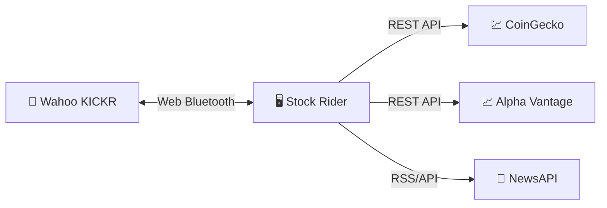

# 🚴‍♂️ Stock Rider

**Ride smart. Learn while you burn.**

Stock Rider is an indoor cycling web app that connects to your Wahoo KICKR (or any FTMS-compatible smart trainer) and replaces the boring virtual ride with **real-world data** — live stock prices, crypto tickers, tech news, and AI/startup content.

> Exercise your body **and** your mind.

---

## 🎯 What Makes This Different?

Every indoor cycling app (Zwift, TrainerRoad, Rouvy) gives you a virtual world. **Stock Rider gives you the real one.**

- 📈 **Live financial data** — crypto prices, stock charts, market movers
- 📰 **Tech & AI news feed** — stay informed while you train
- 🚀 **Startup spotlight** — discover new companies each ride
- 🎥 **YouTube-ready** — built for content creation with OBS overlay support

---

## ✨ Features

| Feature | Status |
|---|---|
| 🔗 Wahoo KICKR connection via Web Bluetooth | 🔜 Phase 1 |
| 🔋 Real-time power, cadence & HR display | 🔜 Phase 1 |
| 📊 Live power graph | 🔜 Phase 1 |
| 💹 Crypto ticker (CoinGecko) | 🔜 Phase 2 |
| 📈 Stock charts (Alpha Vantage) | 🔜 Phase 2 |
| 📰 Tech/AI news feed | 🔜 Phase 2 |
| 🎬 OBS overlay mode | 🔜 Phase 3 |
| 📱 PWA (installable) | 🔜 Phase 4 |

---

## 🛠️ Tech Stack

- **Frontend**: React + TypeScript (Vite)
- **Bluetooth**: Web Bluetooth API (FTMS protocol)
- **Charts**: TradingView Lightweight Charts
- **Styling**: Vanilla CSS — dark "Bloomberg Terminal" HUD aesthetic
- **Hosting**: Vercel

---

## 🚀 Getting Started

### Prerequisites

- **Browser**: Chrome or Edge (Web Bluetooth required)
- **Trainer**: Wahoo KICKR or any BLE/FTMS-compatible smart trainer
- **Node.js**: v18+

### Install & Run

```bash
# Clone the repo
git clone https://github.com/AdrianBesleaga/stock-rider.git
cd stock-rider

# Install dependencies
npm install

# Start dev server
npm run dev
```

Open [http://localhost:5173](http://localhost:5173) in Chrome and click **Connect Trainer** to pair your device.

---

## 🏗️ Architecture



---

## 📐 UI Preview

```
┌──────────────────────────────────────────────────────────┐
│  📡 STOCK RIDER          [BTC ▲ 52,340]  [ETH ▼ 3,210]  │
├────────────────────┬─────────────────────────────────────┤
│   🔋 POWER: 245W  │     📈 MAIN CHART / NEWS FEED       │
│   🚴 CADENCE: 88  │                                     │
│   ❤️ HR: 155 bpm  │                                     │
│   ⏱️ TIME: 32:15  │                                     │
├────────────────────┼─────────────────────────────────────┤
│  POWER GRAPH ~~~~~~│  📰 TECH / AI / STARTUP FEED        │
└────────────────────┴─────────────────────────────────────┘
```

---

## 🤝 Compatible Trainers

Stock Rider uses the **Fitness Machine Service (FTMS)** BLE standard, so it works with:

- ✅ Wahoo KICKR / KICKR Core / KICKR Snap
- ✅ Tacx Neo / Flux / Flow
- ✅ Elite Direto / Suito / Zumo
- ✅ Any FTMS-compatible BLE trainer
- ✅ BLE Heart Rate Monitors
- ✅ BLE Cadence/Speed Sensors

---

## 🎥 YouTube Channel

Stock Rider is designed to be the companion app for a YouTube channel covering **tech, AI, and startup culture** — all while cycling. Every ride is an episode.

---

## 📄 License

MIT

---

## 🔗 Links

- [📋 Full Plan](./Plan.MD)
- **Open-source references**: [BFree](https://github.com/bfree-trainer/bfree) · [Incyclist](https://github.com/incyclist/desktop)
