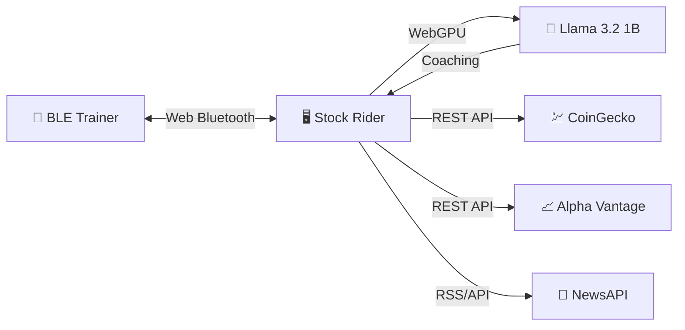

# 🚴‍♂️ Stock Rider

**Ride smart. Learn while you burn.**

Stock Rider is an indoor cycling web app that connects to your Wahoo KICKR (or any FTMS-compatible smart trainer) and replaces the boring virtual ride with **real-world data** — live stock prices, crypto tickers, tech news, and an **in-browser AI coach** powered by WebLLM.

> Exercise your body **and** your mind.

---

## 🎯 What Makes This Different?

Every indoor cycling app (Zwift, TrainerRoad, Rouvy) gives you a virtual world. **Stock Rider gives you the real one.**

| Stock Rider | Competitors |
|---|---|
| 🧠 **AI coach runs in-browser** (WebLLM, zero backend) | All AI is server-side |
| 📈 Live stock & crypto data during rides | Virtual scenery only |
| 📰 Tech/AI/startup news while you train | No real-world content |
| 🔒 Privacy-first — data never leaves your device | Cloud-dependent |
| 💰 Zero API costs for AI | Per-user server costs |

---

## ✨ Current Features

### 🚲 Cycling Core
- **BLE Trainer Connection** — Web Bluetooth (FTMS protocol), Wahoo KICKR, Tacx, Elite, any FTMS device
- **Real-time Metrics** — power (W), cadence (RPM), heart rate (BPM), speed, distance, calories, elapsed time
- **Live Power Graph** — real-time power curve visualization
- **HR Zones** — heart rate zone display with zone-based coloring
- **Ride History** — localStorage-based ride tracking with session stats
- **Strava Export** — download rides as TCX files for Strava upload
- **Session Summary** — post-ride stats card with key metrics
- **Demo Mode** — full mock trainer with simulated data for testing without hardware

### 🧠 AI Coach (WebLLM)
- **In-Browser LLM** — Llama-3.2-1B-Instruct running entirely client-side via WebGPU
- **Real-time Coaching** — personalized messages from live power/HR/cadence/speed data
- **Silent Fallback** — gracefully falls back to static cycling facts when WebGPU is unavailable
- **Progress Tracking** — model download progress bar + badge indicators
- **Zero Backend** — no server, no API keys, no costs

### 🎯 Motivational System
- **90+ Cycling Facts & Quotes** — categorized by Road, MTB, and motivation
- **Smart Queue** — shuffled with ~70/30 fact-to-motivation ratio
- **Road/MTB Modes** — distinct content pools per ride style
- **Auto-rotation** — messages rotate every 20 seconds with fade animations

### 📈 Financial Data
- **Crypto Ticker Bar** — live prices from CoinGecko (BTC, ETH, SOL, etc.)
- **Stock Charts** — TradingView-style charts (NVDA, AAPL, MSFT, TSLA, etc.)
- **Auto-refresh** — tickers update on configurable intervals

### 📰 Content Feeds
- **Tech/AI News** — curated news with category filtering
- **Startup Spotlight** — discover new companies each ride
- **Flashcards** — knowledge cards synced to cadence
- **Custom RSS Feeds** — add your own feed URLs in settings

### 🎮 3D Environment
- **Procedural S-Curve Road** — sine-wave generated road with smooth curves
- **Road/MTB Visual Styles** — dark asphalt + cyan neon (Road) vs earth-toned + amber (MTB)
- **Animated Cyclist** — 3D rider with pedaling animation synced to real cadence
- **Cyberpunk Environment** — neon grid, holographic checkpoints, floating data panels

### ⚙️ Settings & Configuration
- **Ride Style Toggle** — Road 🚴 / MTB 🚵 switch
- **AI Coach Toggle** — enable/disable in-browser LLM
- **Voice Briefing** — TTS reads news headlines (browser Speech Synthesis API)
- **OBS Overlay Mode** — transparent background for streaming
- **Founder Dashboard** — company metrics tracking (MRR, DAU, etc.)

---

## 🔮 Roadmap — Next to Implement

### Priority 1 — Core Experience
- [ ] **ERG Mode** — control trainer resistance from the app
- [ ] **Structured Workouts** — interval training with power targets
- [ ] **PWA Support** — installable as native app, offline-capable
- [ ] **Mobile Responsive** — optimized layout for phone/tablet

### Priority 2 — AI Enhancements
- [ ] **AI Ride Narrator** — live commentary like a cycling race broadcast
- [ ] **AI Training Plans** — personalized multi-week plans from ride history
- [ ] **AI FTP Estimation** — predict FTP without formal testing
- [ ] **Voice AI Coach** — TTS reads AI coaching messages aloud

### Priority 3 — Social & Gamification
- [ ] **Strava Live Upload** — auto-sync rides on completion
- [ ] **Leaderboards** — compare rides with friends
- [ ] **Achievements** — badges for milestones (distance, power PRs, streak)
- [ ] **Multiplayer** — ride with friends in the 3D environment

### Priority 4 — Content & Data
- [ ] **Portfolio Tracker** — track your actual holdings during rides
- [ ] **Earnings Calendar** — get notified about earnings during rides
- [ ] **Custom News Sources** — RSS/Atom feed integration
- [ ] **Ride Analytics Dashboard** — trends over time, training load

---

## 🛠️ Tech Stack

| Layer | Technology |
|---|---|
| **Frontend** | React 19 + TypeScript (Vite) |
| **3D Engine** | Three.js + React Three Fiber |
| **AI** | @mlc-ai/web-llm (Llama-3.2-1B, WebGPU) |
| **Bluetooth** | Web Bluetooth API (FTMS protocol) |
| **Charts** | TradingView Lightweight Charts |
| **Styling** | Vanilla CSS — dark cyberpunk HUD |
| **Testing** | Vitest (102 tests) |
| **Hosting** | Vercel |

---

## 🚀 Getting Started

### Prerequisites

- **Browser**: Chrome or Edge (Web Bluetooth + WebGPU)
- **Trainer**: Any BLE/FTMS-compatible smart trainer (or use Demo Mode)
- **Node.js**: v18+

### Install & Run

```bash
git clone https://github.com/AdrianBesleaga/stock-rider.git
cd stock-rider
npm install
npm run dev
```

Open [http://localhost:5173](http://localhost:5173) and click **Start Ride** → **Connect Trainer** (or enable Demo Mode in Settings).

### Run Tests

```bash
npx vitest run
```

---

## 🏗️ Architecture



---

## 🤝 Compatible Trainers

Stock Rider uses the **Fitness Machine Service (FTMS)** BLE standard:

- ✅ Wahoo KICKR / KICKR Core / KICKR Snap
- ✅ Tacx Neo / Flux / Flow
- ✅ Elite Direto / Suito / Zumo
- ✅ Any FTMS-compatible BLE trainer
- ✅ BLE Heart Rate Monitors
- ✅ BLE Cadence/Speed Sensors

---

## 📄 License

MIT

---

## 🔗 Links

- [📋 Full Plan](./Plan.MD)
- **Open-source references**: [BFree](https://github.com/bfree-trainer/bfree) · [Incyclist](https://github.com/incyclist/desktop)
